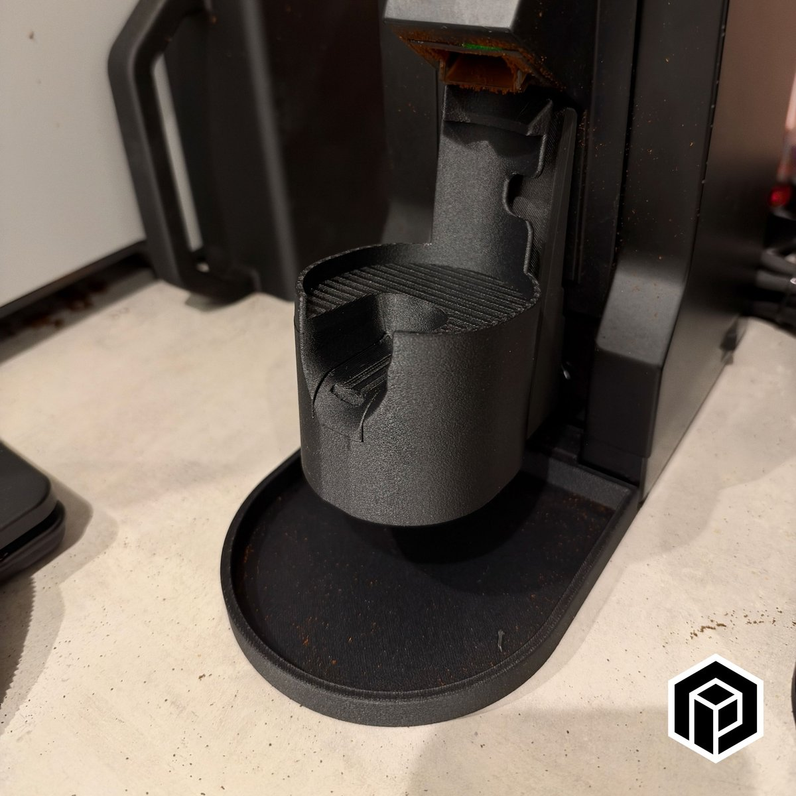
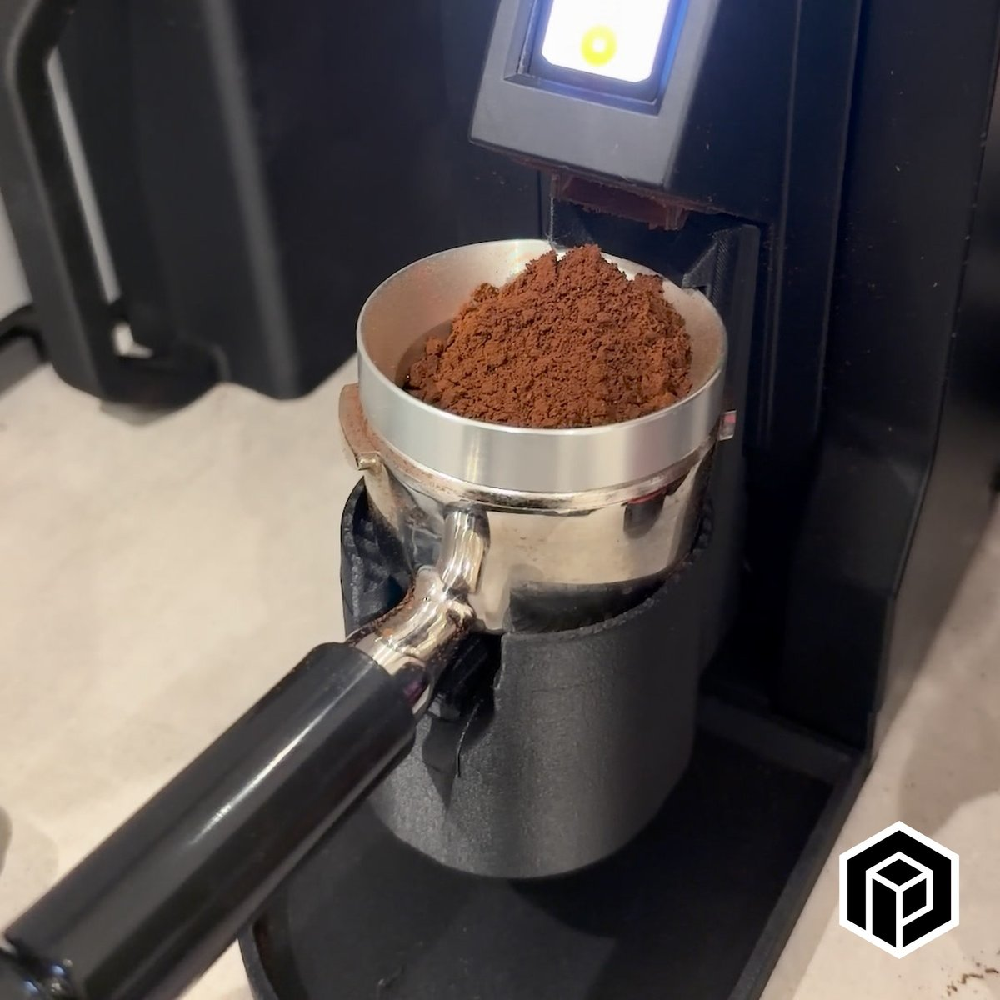
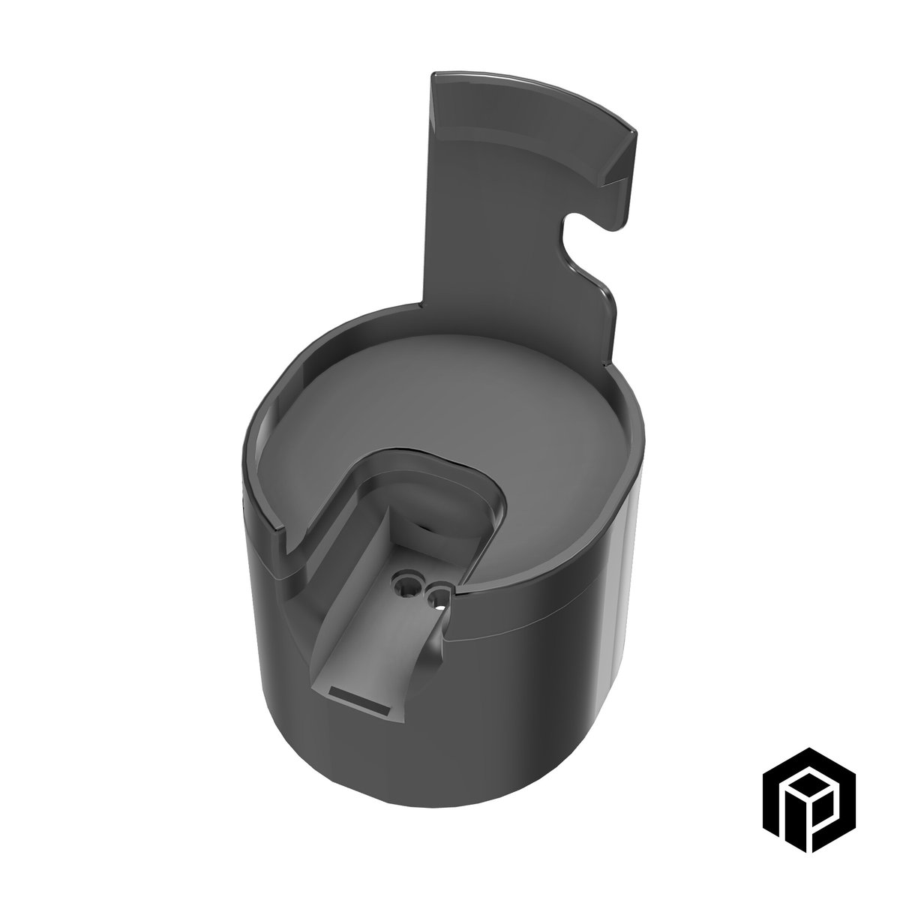

# Eureka Specialita Latch Holder

Portafilter holder for a Eureka Mignon Specialità fitted with this mod. It screws onto the load cell, so the scale weighs the portafilter while you grind. A raised back wall with a lip hooks over the rim of a 58 mm dosing funnel and holds the portafilter steady, and a slide-in cover hides the screws. The cup and back wall lean back 5° so the grounds land in the middle of the basket.

MakerWorld (print profile, BOM and video): [Eureka Specialita Latch Holder – Grind by Weight](https://makerworld.com/en/@PrinterMcGee)

  

## Files

| File | What it is |
|---|---|
| `EurekaCupLatchHolder_H3C.3mf` | Bambu Studio project for the H3C: one plate with both parts, ABS-GF |
| `Eureka_Specialita_Cup_Latch_Holder.stl` | Holder, standing on its base as printed |
| `Eureka_Specialita_Cup_Latch_Screw_Cover.stl` | Slide-in screw cover, flat as printed |
| `Eureka_Specialita_Cup_Latch_Holder.step` | Both parts in their assembled positions, for remixing |

## What you need

- Printed: holder × 1, screw cover × 1
- 2 × M3×10 flat head (countersunk) screws. The holes are countersunk, so socket or button heads stand too tall for the cover.
- The load cell, back plate and electronics from this project's [hardware installation guide](../../docs/HARDWARE_INSTALLATION.md)
- A 58 mm dosing funnel for the lip to latch over

## Print settings

The H3C profile uses Bambu ABS-GF on a 0.4 mm nozzle: 0.20 mm layers, 3 walls, 15% infill, textured PEI plate. Tree supports are on (build plate only); they're only needed under the load cell pocket inside the base.

ABS-GF needs an enclosed printer. On an open-frame printer, use PETG or a matte PLA. The cup floor is tilted 5°, so expect small ridges where the layers step.

## Assembly

1. Fit the back plate, load cell and HX711 as the [hardware installation guide](../../docs/HARDWARE_INSTALLATION.md) describes.
2. Set the holder on the load cell and fix it with the two M3×10 countersunk screws through the floor of the slot.
3. Slide the screw cover into the slot from the front until it sits flush.
4. Calibrate the scale. Put the dosing funnel on the portafilter and drop it in with the handle facing out; the lip hooks over the funnel rim.

## Measurements

- Holder: 70 × 84 × 112 mm; cup 65 mm inside, 70 mm outside
- Screw cover: 18.6 × 41.2 × 14.5 mm
- Screw holes: 3.3 mm with a 90° countersink, 7 mm apart

Pairs with the [magnetic tray](../specialita_magnetic_tray/).

## Changelog

- v2.0 – 25 Nov 2026 – cup and back wall tilted back 5° so grounds land centred; lip hangs 5 mm over the funnel rim (was 4 mm)
- v1.0 – 5 Oct 2026 – first version

## Licence

These model files are CC BY-NC-SA 4.0, by s31teg (Printer McGee). The firmware in this repository keeps its own licence.
