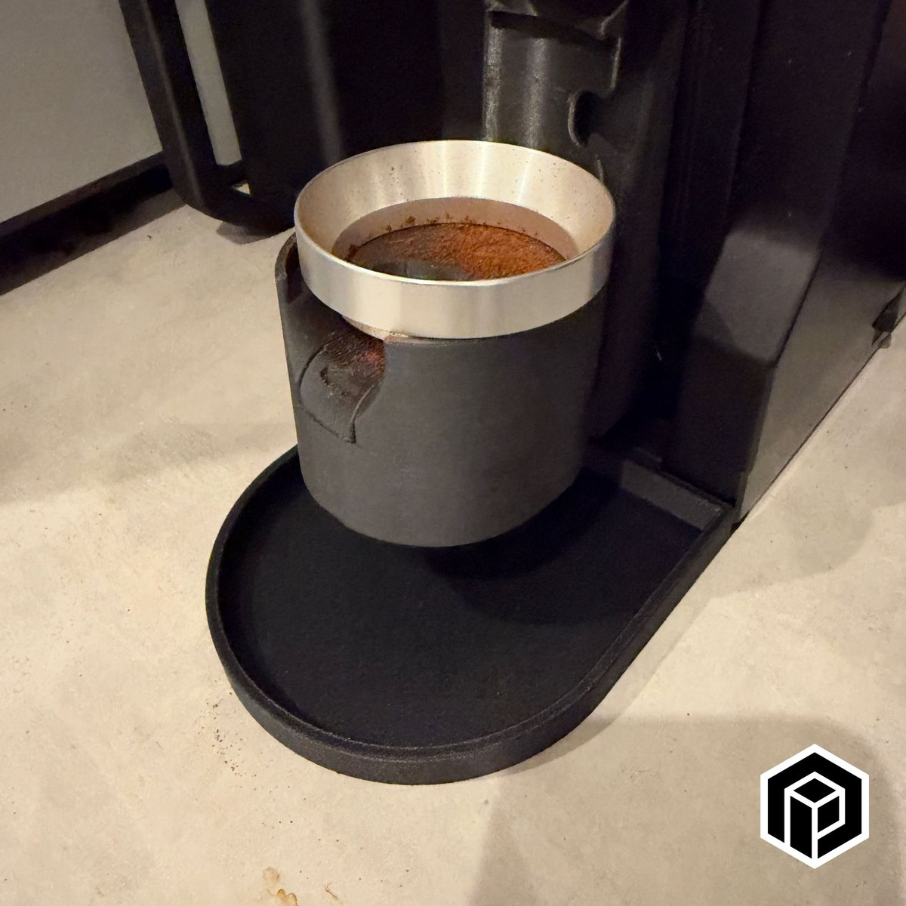
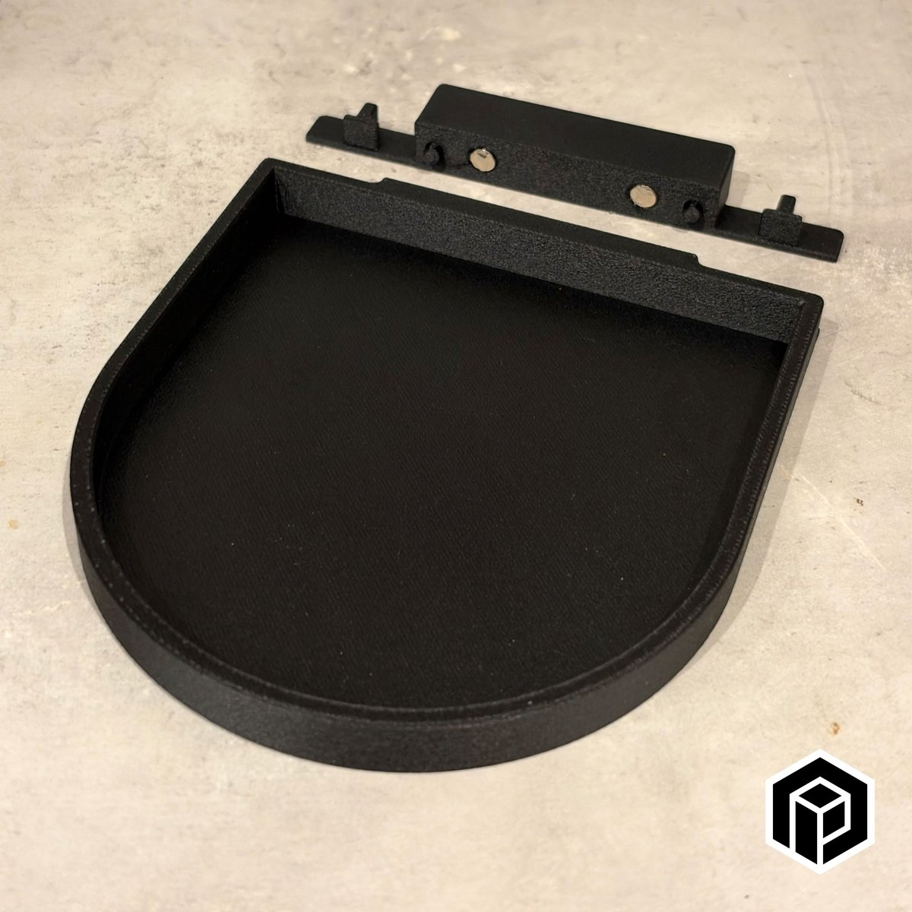
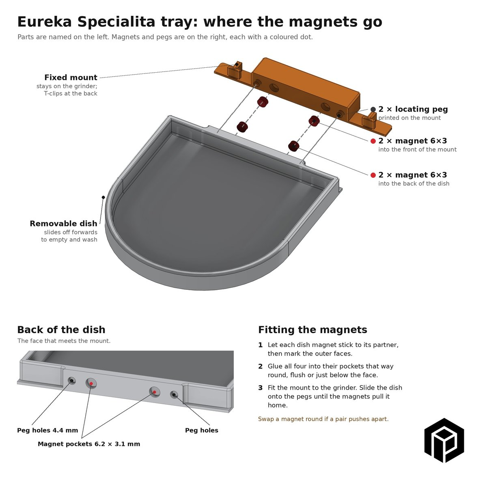

# Eureka Specialita Magnetic Tray

Grounds tray for a Eureka Mignon Specialità fitted with this mod. With the mod the portafilter holder hangs on the load cell, so the tray is a separate part. It comes in two pieces: a small mount stays on the grinder and the dish slides off on magnets, so you can empty and wash it without disturbing the holder or the load cell.

MakerWorld (print profile, BOM and video): [Eureka Specialita Magnetic Tray – Grind by Weight](https://makerworld.com/en/models/3678273-eureka-specialita-magnetic-tray-grind-by-weight)

  

## Files

| File | What it is |
|---|---|
| `EurekaSpecialitaTray_H3C.3mf` | Bambu Studio project for the H3C: one plate with both parts, ABS-GF |
| `Eureka_Specialita_Tray_dish.stl` | Removable dish, flat as printed |
| `Eureka_Specialita_Tray_mount.stl` | Fixed mount with the locating pegs, flat as printed |
| `Eureka_Specialita_Tray.step` | Both parts, for remixing |

## What you need

- Printed: dish × 1, mount × 1
- 4 × 6×3 mm round magnets
- Superglue or two-part epoxy to fix the magnets

## Print settings

The H3C profile uses Bambu ABS-GF on a 0.4 mm nozzle: 0.20 mm layers, 3 walls, 15% infill, textured PEI plate. Both parts print flat and need no supports. About 1 h 42 min and 45 g.

ABS-GF needs an enclosed printer. On an open-frame printer, PETG or PLA works; check that your magnets press into the 6.2 mm pockets before printing a full set.

## Assembly

1. Pair up the magnets first: let each dish magnet stick to its partner, then mark the outer faces so they go in the right way round.
2. Glue a magnet into each of the four pockets (two in the back face of the dish, two in the mount), flush with or just below the surface. Let the glue cure.
3. Fit the mount to the grinder; the T-clips at the back locate it.
4. Slide the dish back onto the pegs until the magnets pull it home. To empty it, slide it straight forwards.

## Measurements

- Overall: 120 × 145 × 12.5 mm (dish 120 × 128.5 mm, mount 120 × 19.5 mm including the pegs)
- Magnet pockets: 6.2 mm across, 3.1 mm deep, for 6×3 mm discs
- Pegs: 4 mm diameter, 3 mm long, into 4.4 mm holes

Pairs with the [latch holder](../specialita_latch_holder/).

## Changelog

- v2.0 – 24 Nov 2026 – split into a fixed mount and a removable dish held by magnets
- v1.0 – 5 Oct 2026 – one-piece tray

## Licence

These model files are CC BY-NC-SA 4.0, by s31teg (Printer McGee). The firmware in this repository keeps its own licence.
